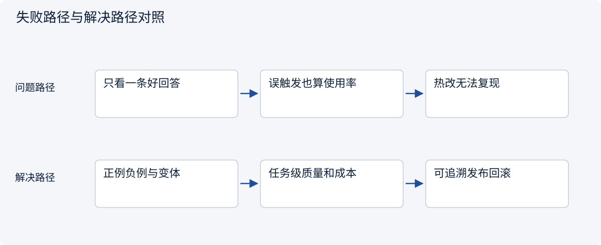
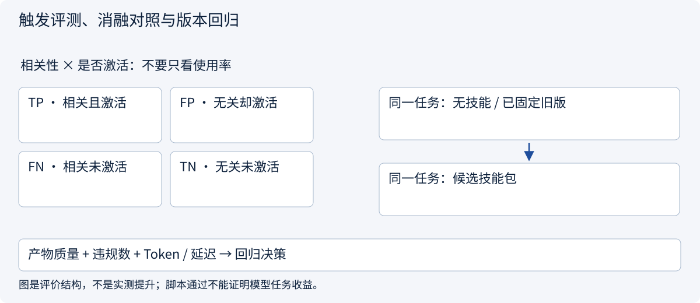
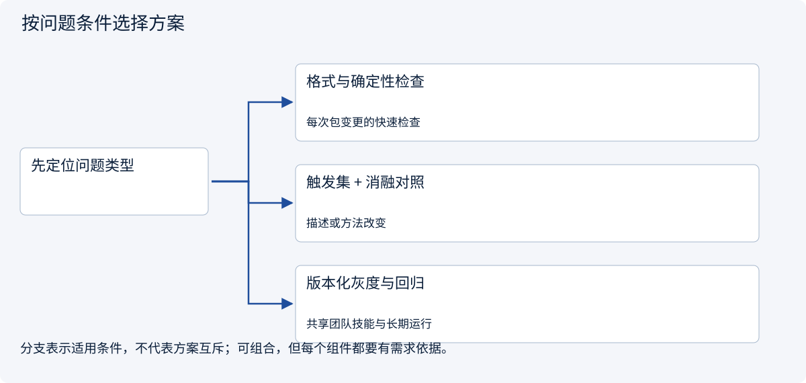
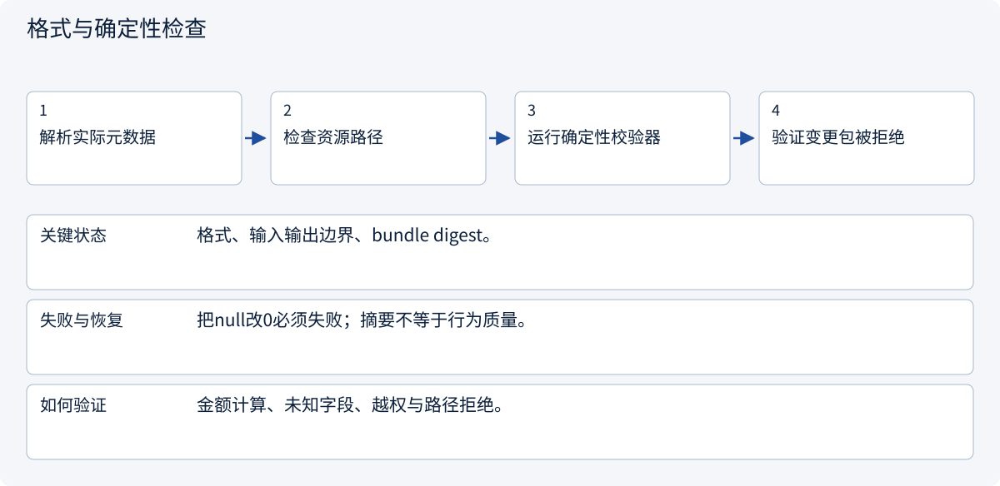
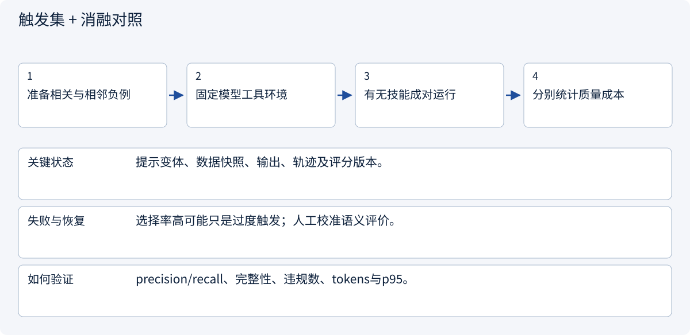
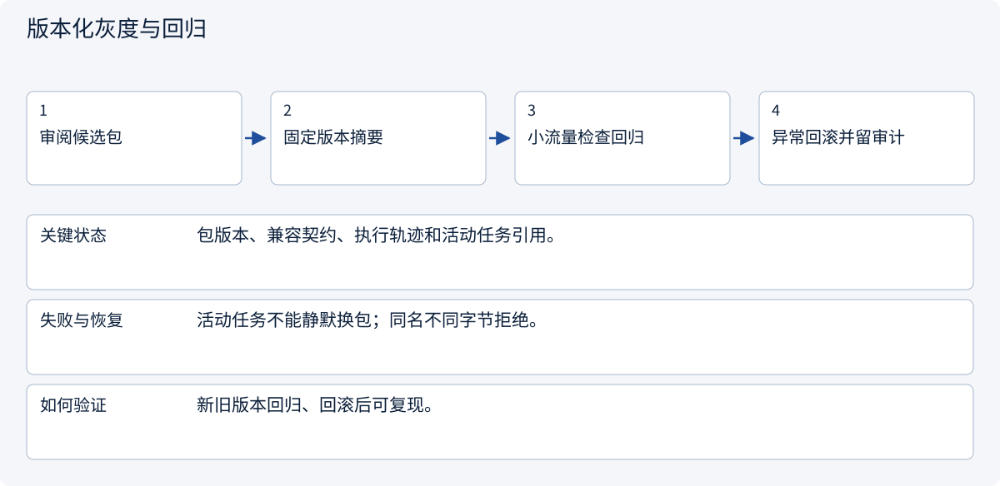

# 2.6.6 触发评测、消融对照与版本回归

> 图解主线 · 对照主流方案 · 配参考代码

基于 Agent Skills 公开格式；版本、摘要固定与工具绑定是本例 Host 约定，不是通用执行权限。

## 先看问题

安装后在一个问题上表现不错，为什么不能证明 Skill 有效？改了 description 或辅助脚本应测什么？



## 图解工作原理

触发质量、产物质量和运行成本分开评；同一批任务做有/无技能及旧/新版对照。固定包摘要与版本便于回归、灰度和回滚，不伪造模型收益。



## 主流方案怎么选



| 方案 | 怎样解决 | 适用条件 | 代价与边界 |
|---|---|---|---|
| 格式与确定性检查 | 验证元数据、路径和产物计算 | 每次包变更的快速检查 | 不能证明模型会正确选择或使用 |
| 触发集 + 消融对照 | 同任务比较选中率和有无技能质量 | 描述或方法改变 | 需固定模型、工具快照与评价规则 |
| 版本化灰度与回归 | 固定包摘要、记录轨迹、回滚旧包 | 共享团队技能与长期运行 | 本例给机制，不部署真实发布平台 |

## 主流方案内部怎样运行

### 1 · 格式与确定性检查



**具体推演：** 校验器检测A运费未知却声称总价180。

### 2 · 触发集 + 消融对照



**具体推演：** 写报价报告该触发，询问天气不该触发；无实测不填虚构分数。

### 3 · 版本化灰度与回归



**具体推演：** 更新比较规则时保留旧任务所绑定的包和产物契约。

## 参考代码

展开查看与本课机制对应的实现。训练函数仅提供代码，不执行实际训练；依赖与验证范围见配套代码说明。

[配套代码说明与验证范围](../../../docs/zh/projects/03-code-guide.md)

<details><summary>展开代码与实现边界</summary>

```python
"""Selection metrics are separate from output quality and operational cost."""

from dataclasses import dataclass


@dataclass(frozen=True)
class SelectionCase:
    should_activate: bool
    activated: bool


def selection_metrics(cases: list[SelectionCase]) -> dict:
    tp = sum(x.should_activate and x.activated for x in cases)
    fp = sum(not x.should_activate and x.activated for x in cases)
    fn = sum(x.should_activate and not x.activated for x in cases)
    return {
        "precision": tp / (tp + fp) if tp + fp else None,
        "recall": tp / (tp + fn) if tp + fn else None,
        "false_activations": fp,
        "missed_activations": fn,
    }


# None means undefined, never a fabricated perfect score.
# Run paired tasks with/without the skill and compare evidence validity, completeness,
# forbidden effects, context tokens and latency. This file does not fabricate model results.
```

</details>

## 先分清三种问题，再谈成功率

1. **选择问题：** 该用没用、无关却用。相关与相邻负例一起测，description 更改后重跑变体集。
2. **执行质量：** 相同模型、工具快照与任务，比较有/无技能、旧/新版；检查报告和实际动作，不只评价文风。
3. **运行代价：** 记录目录/正文/资源注入量、重复激活、延迟、费用与恢复失败。使用率高本身不是收益。

| 回归变更 | 最少需要观察 |
|---|---|
| 改 description | 正例、负例、近邻任务的选择精确率与召回 |
| 改比较方法 | 未知运费、币种、数量条件、引用与产物完整性 |
| 改辅助脚本 | 正常、边界及错误输入；固定摘要随受审发布更新 |
| 改注册版本 | 活动任务固定版本、可重现记录、新任务切换与回滚 |

选择精确率 TP/(TP+FP)，召回率 TP/(TP+FN)；分母为0返回未定义，不填100%。语义产物可由人工/校准 Judge 辅助评分，但金额、权限和重复写应独立确定性断言。

当前只运行格式、辅助函数、加载和权限契约，没有模型选用实验，因此没有“提升百分比”。它属于 Agent 架构的评测模块；运行轨迹接监控模块，代码来源与权限接安全模块，三个模块协作但证据不能互相替代。


依据：[Official 1](https://agentskills.io/skill-creation/evaluating-skills)。


## 改变条件，检查理解

脚本测试通过，能否报告 Skill 让模型成功率提高20%？

<details><summary>展开参考答案</summary>

不能。脚本正确性与模型任务增益不同；没有成对任务实测就没有提升数据。示例只验证契约和计算，不调用模型。

</details>

[查看官方资料与方案依据](../../../docs/zh/resources.md)
