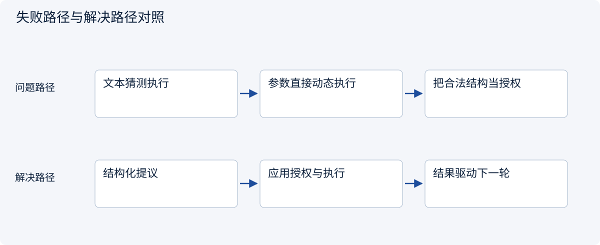
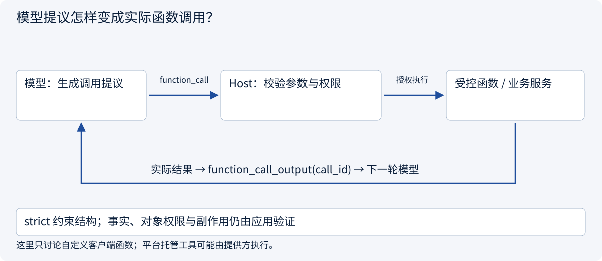
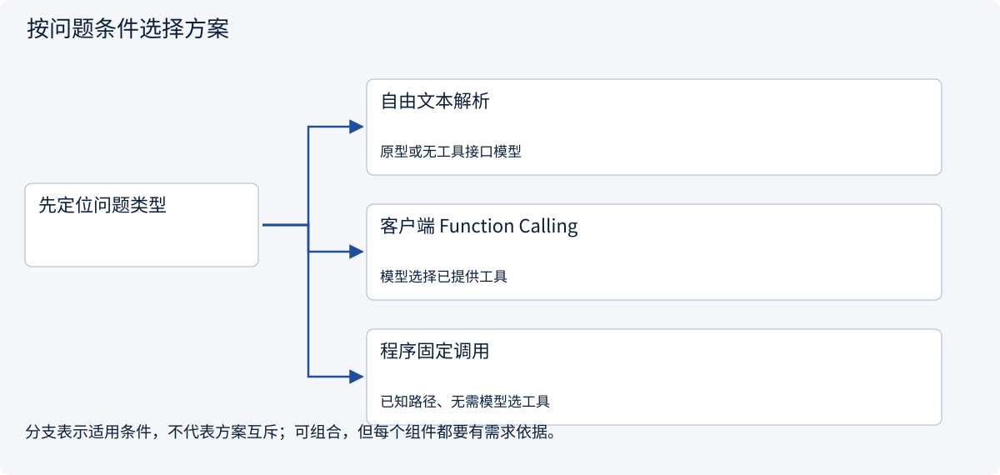
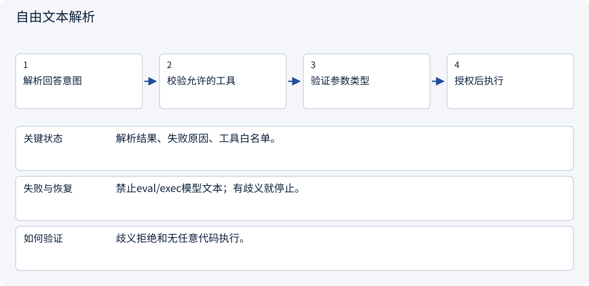
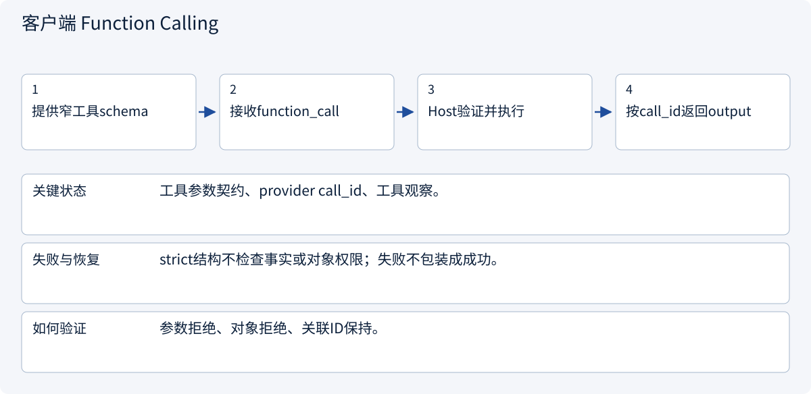
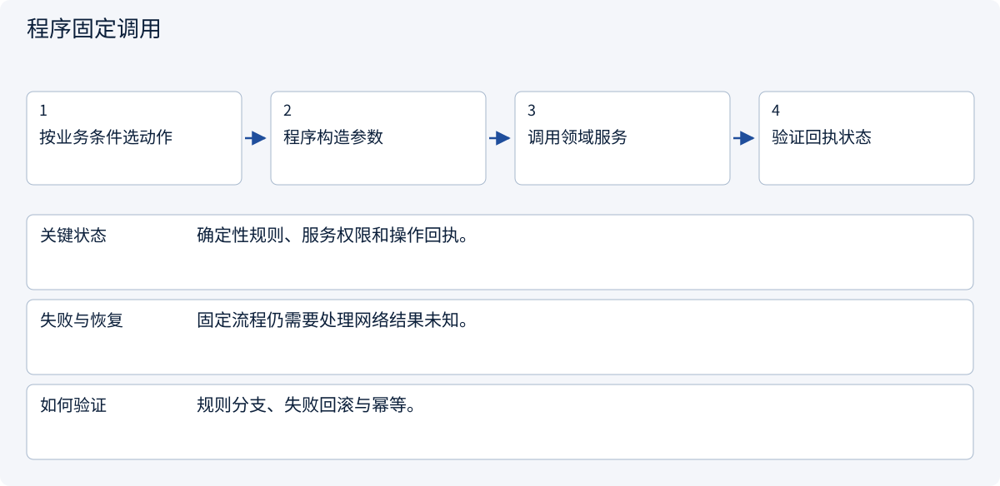

# 2.4.2 模型提议怎样变成实际函数调用？

> 图解主线 · 对照主流方案 · 配参考代码

模型侧示例采用 Responses 的自定义客户端函数形状；不发送模型请求。

## 先看问题

模型返回了工具名和 JSON 参数，为什么函数还没有执行？strict=true 能保证权限和业务正确吗？




## 图解工作原理

自定义客户端 Function Calling 是模型侧工具契约与结构化提议；应用负责验证、授权、执行，并用原 call_id 回传工具观察。受托平台工具可由提供方执行，要与本例区分。



## 主流方案怎么选



| 方案 | 怎样解决 | 适用条件 | 代价与边界 |
|---|---|---|---|
| 自由文本解析 | 从回答提取工具意图 | 原型或无工具接口模型 | 歧义大、难约束，不能当可靠执行契约 |
| 客户端 Function Calling | schema定义参数，应用运行工具 | 模型选择已提供工具 | 需处理拒答、无调用、多调用和错误 |
| 程序固定调用 | 业务流程直接决定函数 | 已知路径、无需模型选工具 | 不必为确定性操作增加模型回合 |

## 主流方案内部怎样运行

### 1 · 自由文本解析



**具体推演：** 不要从“我已创建”一句话判定远端真的创建。

<details><summary>展开文字步骤、状态与失败边界</summary>

1. 解析回答意图
2. 校验允许的工具
3. 验证参数类型
4. 授权后执行

**关键状态** 解析结果、失败原因、工具白名单。

**失败与恢复** 禁止eval/exec模型文本；有歧义就停止。

**如何验证** 歧义拒绝和无任意代码执行。

</details>

### 2 · 客户端 Function Calling



**具体推演：** read_quote(A)由Host调用服务后才得到真实报价。

<details><summary>展开文字步骤、状态与失败边界</summary>

1. 提供窄工具schema
2. 接收function_call
3. Host验证并执行
4. 按call_id返回output

**关键状态** 工具参数契约、provider call_id、工具观察。

**失败与恢复** strict结构不检查事实或对象权限；失败不包装成成功。

**如何验证** 参数拒绝、对象拒绝、关联ID保持。

</details>

### 3 · 程序固定调用



**具体推演：** 已知报价ID的读取不需要先请模型决定是否读取。

<details><summary>展开文字步骤、状态与失败边界</summary>

1. 按业务条件选动作
2. 程序构造参数
3. 调用领域服务
4. 验证回执状态

**关键状态** 确定性规则、服务权限和操作回执。

**失败与恢复** 固定流程仍需要处理网络结果未知。

**如何验证** 规则分支、失败回滚与幂等。

</details>

## 参考代码

展开查看与本课机制对应的实现。训练函数仅提供代码，不执行实际训练；依赖与验证范围见配套代码说明。

[配套代码说明与验证范围](../projects/03-code-guide.md)

<details><summary>展开代码与实现边界</summary>

```python
"""OpenAI Responses client-function shape, without a model request or credentials.

This adapter deliberately supports only the read_quote contract. It is not a
universal JSON Schema translator. Schema-valid arguments still need authorization.
"""

import json


def quotation_tool() -> dict:
    return {
        "type": "function",
        "name": "read_quote",
        "description": "Read an authorized quote.",
        "strict": True,
        "parameters": {
            "type": "object",
            "properties": {"quote_id": {"type": "string"}},
            "required": ["quote_id"],
            "additionalProperties": False,
        },
    }


def parse_proposal(item: dict) -> tuple[str, dict]:
    if item.get("type") != "function_call" or item.get("name") != "read_quote":
        raise ValueError("Unsupported client-function proposal")
    call_id = item.get("call_id")
    if not isinstance(call_id, str) or not call_id:
        raise ValueError("Missing provider call correlation ID")
    arguments = json.loads(item["arguments"])
    if (
        not isinstance(arguments, dict)
        or set(arguments) != {"quote_id"}
        or not isinstance(arguments["quote_id"], str)
    ):
        raise ValueError("Invalid read_quote arguments")
    return call_id, arguments


async def handle_proposal(item: dict, execute) -> dict:
    call_id, arguments = parse_proposal(item)
    result = await execute(
        "read_quote", arguments
    )  # Host gateway, not arbitrary getattr/exec.
    return {
        "type": "function_call_output",
        "call_id": call_id,
        "output": json.dumps(result, ensure_ascii=False, allow_nan=False),
    }


# Return this tool output alongside required conversation/reasoning items for the next turn.
# This example handles one client function; provider-managed tools may execute server-side.
```

</details>

## 一次客户端工具回合

先区分普通函数调用与模型 Function Calling：前者是程序已经进入函数执行；后者在本例中是模型产生调用提议，直到 Host 执行才发生实际调用。

1. 应用向模型提供函数描述与参数 schema。
2. 模型可返回普通文本、拒答、一个或多个工具调用；没有调用时不能硬执行默认工具。
3. Host 对每个提议验证工具名、参数、资源范围和当前业务状态，再调用受控函数。
4. 将真实结果按原 call_id 回传，模型据此继续回答。失败也要分类返回，不能编造成功回执。

本例采用 Responses 的 function_call / function_call_output 形状；Chat Completions 的工具消息、其他提供方的 tool_use/tool_result 并不相同。适配器只支持明确的 read_quote 参数契约，不冒充通用 schema 转换器；不演示完整流式聚合、并发调度或付费模型调用。

strict=true 有助于约束参数结构，不能证明对象可访问、价格有证据或业务动作已发生。流式参数要等该调用完整结束并校验后再执行；不能边收到一段 JSON 边触发写入。


依据：[OpenAI Function Calling](https://developers.openai.com/api/docs/guides/function-calling), [Anthropic Tool Use](https://platform.claude.com/docs/en/agents-and-tools/tool-use/overview)。


## 改变条件，检查理解

模型提议读取 B，但任务只允许 A；参数完全符合 schema，能调用吗？

<details><summary>展开参考答案</summary>

不能。schema验证形状，任务授权验证可用工具和对象。call_id 只是关联模型工具结果，不是审批或幂等凭证。

</details>

[查看官方资料与方案依据](../resources.md)
