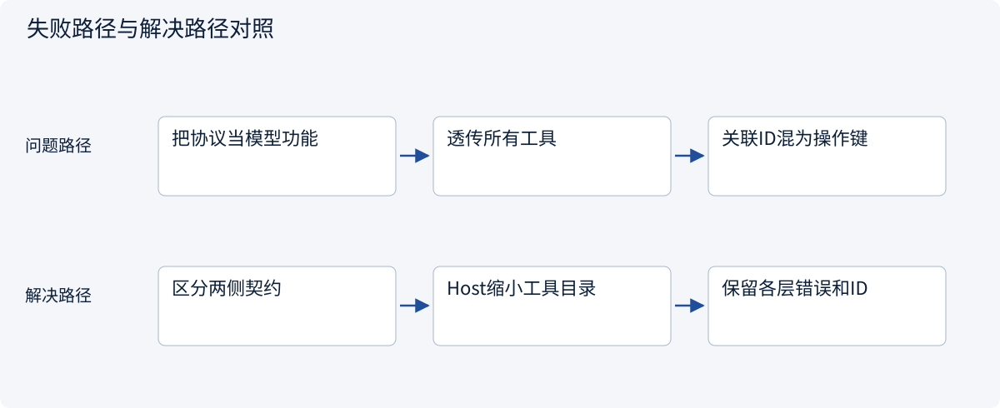
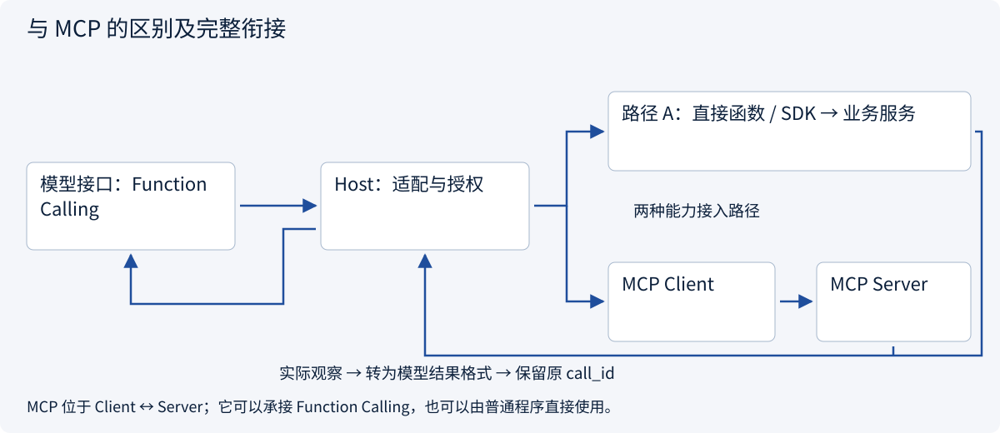
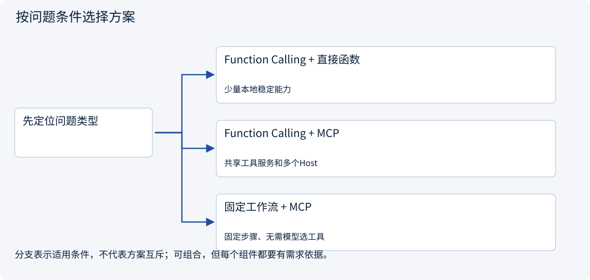
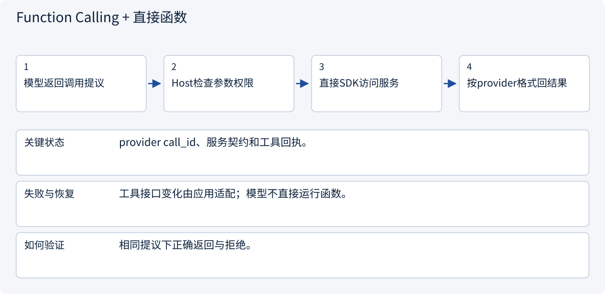
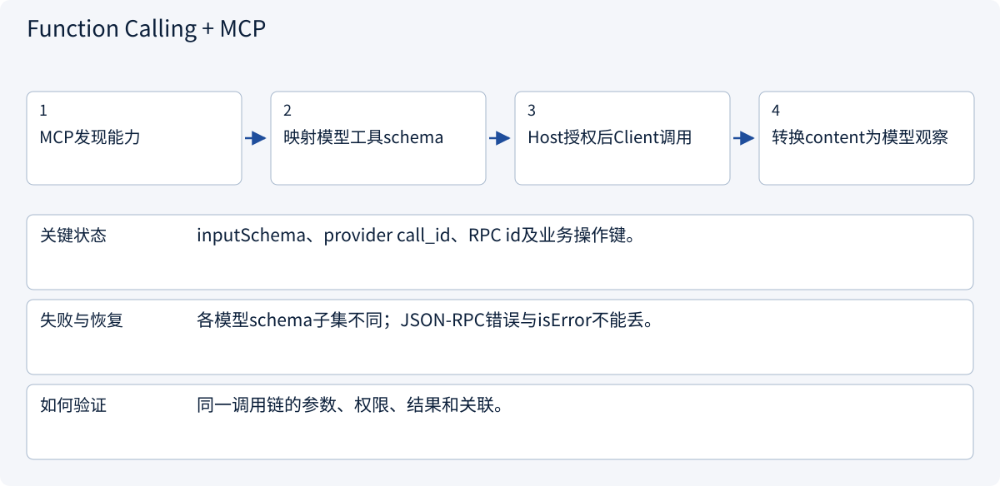
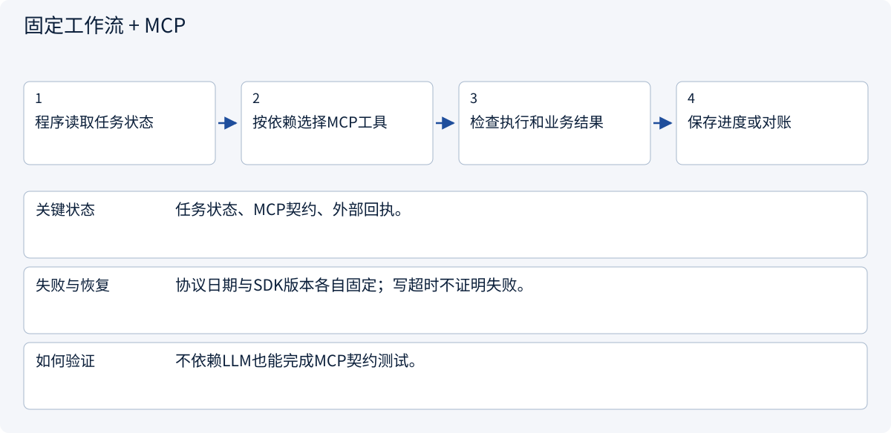

# 2.4.3 与 MCP 的区别及完整衔接

> 图解主线 · 对照主流方案 · 配参考代码

模型侧示例采用 Responses 的自定义客户端函数形状；不发送模型请求。

## 先看问题

Function Calling 和 MCP 都能“调用工具”，为什么不是二选一？把 MCP inputSchema 原样贴给模型就够了吗？



## 图解工作原理

Function Calling 位于模型与应用之间；MCP 位于应用 Client 与能力 Server 之间。Host 转换 schema、校验权限与参数、映射结果；同一个模型提议可以走直接 SDK 或 MCP。



## 主流方案怎么选



| 方案 | 怎样解决 | 适用条件 | 代价与边界 |
|---|---|---|---|
| Function Calling + 直接函数 | Host把提议分发给注册函数/SDK | 少量本地稳定能力 | 每类后端适配独立维护 |
| Function Calling + MCP | Host通过MCP Client调用外部Server | 共享工具服务和多个Host | 额外传输、认证和契约适配 |
| 固定工作流 + MCP | 程序决定何时调用MCP | 固定步骤、无需模型选工具 | 有MCP并不必然存在Function Calling |

## 主流方案内部怎样运行

### 1 · Function Calling + 直接函数



**具体推演：** 报价业务服务既能给SDK适配器使用，也能被MCP Server包装。

### 2 · Function Calling + MCP



**具体推演：** function_call(read_quote,A)最终变为MCP tools/call；返回仍用原call_id。

### 3 · 固定工作流 + MCP



**具体推演：** Client(server)的真实只读测试不需要Function Calling响应。

## 参考代码

展开查看与本课机制对应的实现。训练函数仅提供代码，不执行实际训练；依赖与验证范围见配套代码说明。

[配套代码说明与验证范围](../../../docs/zh/projects/03-code-guide.md)

<details><summary>展开代码与实现边界</summary>

```python
"""Both interfaces in one chain: provider function proposal → Host → MCP → observation."""

from .function_calling import handle_proposal, parse_proposal
from .mcp_host_bridge import call_authorized, check_quote_access
from .mcp_server_example import build_server


async def resolve_via_mcp(item: dict) -> dict:
    from mcp import Client

    _, arguments = parse_proposal(item)
    check_quote_access(
        "read_quote", arguments, frozenset({"read_quote"}), frozenset({"A"})
    )
    async with Client(build_server()) as client:

        async def execute(name, arguments):
            # Trusted task scope is injected by the application, never taken from item.
            return await call_authorized(
                client, name, arguments, frozenset({"read_quote"}), frozenset({"A"})
            )

        return await handle_proposal(item, execute)


# Provider call_id correlates model tool output; MCP request id correlates one RPC.
# Neither is the operation_id required to deduplicate an external business write.
```

</details>

## 两个接口，处于不同层

| 维度 | Function Calling（本例客户端工具） | MCP |
|---|---|---|
| 两端 | 模型提供方接口 ↔ Host 应用 | MCP Client ↔ MCP Server |
| 主要内容 | 工具 schema、调用提议、模型工具观察 | 能力发现、工具/资源/模板、RPC 与传输 |
| 谁执行 | Host 分发到函数/SDK，也可转交 MCP | Server 调领域服务；Client 接结果 |
| 没有另一方能用吗 | 能，直接分发本地函数 | 能，普通程序可直接调用 SDK Client |
| 授权 | Host 与领域服务落实 | 认证/对象授权仍要落实 |

**共同出现的时序：** MCP list_tools → Host筛选工具并适配模型 schema → 模型 function_call → Host参数/对象检查 → Client tools/call → Server service → Host映射结果 → 原call_id的 function_call_output。MCP Server 不必知道这个调用原来来自哪个模型。

**不要混淆三个 ID：** provider call_id 关联模型观察；JSON-RPC id 关联一次 MCP 请求；operation_id 在业务层标识跨重试的同一写动作。前两者不会自动保证业务幂等。

本例复用真实 MCP SDK，但模型提议是固定测试输入。另一条直接 SDK 路径无需 MCP；固定工作流用 MCP 时也无需生成 Function Calling。Function Calling 与 MCP 的 schema 约束、错误层次及版本各自不同，必须在 Host 边界适配。


依据：[Official 1](https://developers.openai.com/api/docs/guides/function-calling), [Official 2](https://modelcontextprotocol.io/docs/2026-07-28/learn/architecture)。


### 模型侧契约与提议校验

Host 示例；固定输入与可注入适配器，不调用模型。

<details><summary>展开代码与实现边界</summary>

```python
"""OpenAI Responses client-function shape, without a model request or credentials.

This adapter deliberately supports only the read_quote contract. It is not a
universal JSON Schema translator. Schema-valid arguments still need authorization.
"""

import json


def quotation_tool() -> dict:
    return {
        "type": "function",
        "name": "read_quote",
        "description": "Read an authorized quote.",
        "strict": True,
        "parameters": {
            "type": "object",
            "properties": {"quote_id": {"type": "string"}},
            "required": ["quote_id"],
            "additionalProperties": False,
        },
    }


def parse_proposal(item: dict) -> tuple[str, dict]:
    if item.get("type") != "function_call" or item.get("name") != "read_quote":
        raise ValueError("Unsupported client-function proposal")
    call_id = item.get("call_id")
    if not isinstance(call_id, str) or not call_id:
        raise ValueError("Missing provider call correlation ID")
    arguments = json.loads(item["arguments"])
    if (
        not isinstance(arguments, dict)
        or set(arguments) != {"quote_id"}
        or not isinstance(arguments["quote_id"], str)
    ):
        raise ValueError("Invalid read_quote arguments")
    return call_id, arguments


async def handle_proposal(item: dict, execute) -> dict:
    call_id, arguments = parse_proposal(item)
    result = await execute(
        "read_quote", arguments
    )  # Host gateway, not arbitrary getattr/exec.
    return {
        "type": "function_call_output",
        "call_id": call_id,
        "output": json.dumps(result, ensure_ascii=False, allow_nan=False),
    }


# Return this tool output alongside required conversation/reasoning items for the next turn.
# This example handles one client function; provider-managed tools may execute server-side.
```

</details>

### Host 到 MCP 的范围检查

Host 示例；固定输入与可注入适配器，不调用模型。

<details><summary>展开代码与实现边界</summary>

```python
"""Host-side validation before an MCP call; the server enforces object scope too."""


def check_quote_access(
    name: str,
    arguments: dict,
    allowed_tools: frozenset[str],
    allowed_quote_ids: frozenset[str],
):
    if name not in allowed_tools:
        raise PermissionError("Tool not exposed to this task")
    if name != "read_quote" or set(arguments) != {"quote_id"}:
        raise ValueError("Unexpected tool contract")
    if not isinstance(arguments["quote_id"], str):
        raise TypeError("quote_id must be a string")
    if arguments["quote_id"] not in allowed_quote_ids:
        raise PermissionError("Quotation outside task scope")


async def call_authorized(
    client,
    name: str,
    arguments: dict,
    allowed_tools: frozenset[str],
    allowed_quote_ids: frozenset[str],
):
    check_quote_access(name, arguments, allowed_tools, allowed_quote_ids)
    result = await client.call_tool(name, arguments)
    if result.is_error:
        raise RuntimeError("Tool execution failed; do not claim task completion")
    return result.structured_content


# A model-provider adapter must map MCP input_schema to the provider's tool format,
# correlate call IDs and return the observation in that provider's expected structure.
# MCP content remains untrusted evidence, not a new system instruction.
```

</details>

## 改变条件，检查理解

没有 MCP 能用 Function Calling 吗？没有模型也能用 MCP 吗？

<details><summary>展开参考答案</summary>

都可以。模型提议可由本地函数执行；普通程序可直接用MCP Client读资源、工具或模板。本例无模型请求也运行真实MCP调用。

</details>

[查看官方资料与方案依据](../../../docs/zh/resources.md)
